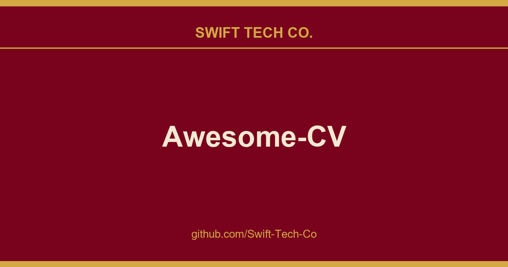

# Awesome-CV

## What This Is

A practical reference entry for product and engineering: the Awesome-CV notes, examples and fixes we reach for repeatedly. Kept current as part of the wider Swift Tech Co. engineering library.

## Images

[](https://github.com/Swift-Tech-Co/Awesome-CV)

## What is Awesome CV?

**Awesome CV** is LaTeX template for a **CV(Curriculum Vitae)**, **Résumé** or **Cover Letter** inspired by Fancy CV. It is easy to customize your own template, especially since it is really written by a clean, semantic markup.

*Thank you for your support!*

## Preview

#### Résumé

You can see PDF

| Page. 1 | Page. 2 |
|:---:|:---:|
| [](https://github.com/Swift-Tech-Co/Awesome-CV)  | [](https://github.com/Swift-Tech-Co/Awesome-CV) |

#### Cover Letter

You can see PDF

| Without Sections | With Sections |
|:---:|:---:|
| [](https://github.com/Swift-Tech-Co/Awesome-CV)  | [](https://github.com/Swift-Tech-Co/Awesome-CV) |

## Quick Start

* **Edit Résumé on OverLeaf.com**
* **Edit Cover Letter on OverLeaf.com**

**_Note:_ Above services do not guarantee up-to-date source code of Awesome CV**

## How to Use

#### Requirements

A full TeX distribution is assumed.  Various distributions for different operating systems (Windows, Mac, \*nix) are available but TeX Live is recommended.
You can install TeX from upstream (recommended; most up-to-date) or use `sudo apt-get install texlive-full` if you really want that.  (It's generally a few years behind.)

If you don't want to install the dependencies on your system, this can also be obtained via Docker.

#### Usage

At a command prompt, run

```bash
xelatex {your-cv}.tex
```

Or using docker:

```bash
docker run --rm --user $(id -u):$(id -g) -i -w "/doc" -v "$PWD":/doc texlive/texlive:latest make
```

In either case, this should result in the creation of ``{your-cv}.pdf``

## Contact

You are free to take my `.tex` file and modify it to create your own resume. Please don't use my resume for anything else without my permission, though!

If you have any questions, feel free to join me at [`#posquit0` on Freenode](irc://irc.freenode.net/posquit0) and ask away. Click here to connect.

Good luck!

## Sources

Compiled and maintained from upstream [posquit0/Awesome-CV](https://github.com/posquit0/Awesome-CV) under permissive open-source license.

---

Maintained by [Swift Tech Co.](https://github.com/Swift-Tech-Co) - [Telegram](https://t.me/+Qt_eFvkb2rliMzNh)

## Sources

Compiled and maintained from upstream [posquit0/Awesome-CV](https://github.com/posquit0/Awesome-CV) under permissive open-source license.

---

Maintained by [Swift Tech Co.](https://github.com/Swift-Tech-Co) - [Telegram](https://t.me/+Qt_eFvkb2rliMzNh)